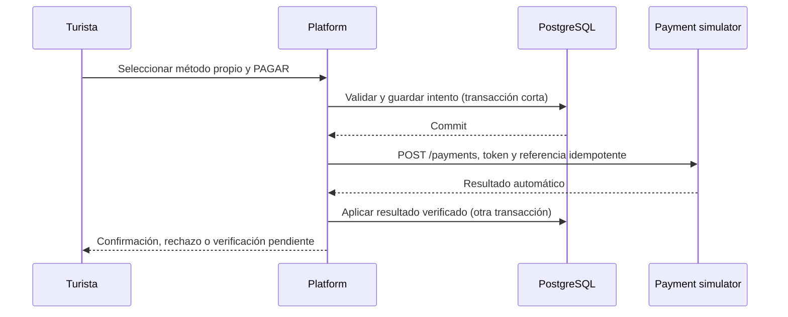

# Pagos ficticios integrados

## Recorrido

1. El turista abre **Mi espacio → Mis métodos de pago** y registra una tarjeta ficticia del listado de este documento. La plataforma valida los datos y los envía por POST al simulador, autenticado mediante X-API-Key.
2. El simulador valida el listado cerrado de tarjetas, titular, CVV y vencimiento; devuelve un token y metadatos enmascarados. Ninguna base guarda PAN completo ni CVV: al simulador le alcanza con una regla de prueba, marca, últimos cuatro dígitos y vencimiento. Uruguay Mnatural guarda el token y esos metadatos, asociados al turista.
3. Crear una reserva retiene cupos durante diez minutos y conserva precio, moneda y política de reembolso. No llama al simulador, no crea un intento ni autoriza un cobro.
4. En el detalle, el turista selecciona un método propio y activo y presiona **PAGAR**. El backend verifica dueño, estado, plazo y ausencia de cancelación o intento incierto. Persiste el intento con una referencia UUID única antes de ejecutar HTTP.
5. El simulador autoriza automáticamente a partir del token y sus reglas. Un método válido aprueba; un método de rechazo, inhabilitado, ajeno, inexistente o vencido rechaza. El endpoint PAGAR rechaza campos adicionales de decisión enviados por el frontend; no hay checkout externo.
6. La plataforma verifica referencia, importe, moneda, vencimiento e identificador remoto. Aprobado confirma y genera código; rechazado conserva el historial y permite **otro método** mientras siga vigente la reserva. El plazo no se extiende al reintentar.
7. Ante un error de comunicación, queda PAYMENT_UNCERTAIN y mantiene cupos. Un nuevo intento se bloquea. La conciliación consulta por la referencia y, si falta la operación, solo reenvía una intención de PAGAR ya persistida, con la misma referencia y método.

## Tarjetas exclusivamente ficticias

Son identificadores de simulación de una lista cerrada; todos fallan Luhn y no son números bancarios utilizables. No deben sustituirse por tarjetas reales.

| Número de prueba | Marca presentada | Resultado automático |
| --- | --- | --- |
| `9900000000004242` | Visa de prueba, terminada en 4242 | Aprueba si el método y la reserva siguen vigentes |
| `9900000000000005` | Mastercard de prueba, terminada en 0005 | Rechaza con CARD_DECLINED |
| `9900000000000003` | Visa de prueba, terminada en 0003 | Rechaza con METHOD_DISABLED |

Usar un titular con letras, mes 1–12 y un año no vencido (hasta 2100); CVV ficticio de tres dígitos, por ejemplo 731. El CVV se valida solo al registrar y nunca se persiste. Las entradas se ocultan y se vacían después del envío. La lista y el HTML solo muestran marca, últimos cuatro dígitos y vencimiento. Una tarjeta ya registrada que venza antes de pagar produce CARD_EXPIRED; las pruebas automatizadas simulan ese paso del tiempo. Un token ajeno o inexistente produce METHOD_NOT_FOUND. Otros números son rechazados durante el registro.

## Persistencia y garantías

- `payment_method`: ID local, turista, token remoto, marca, últimos cuatro dígitos, titular, vencimiento, estado activo y creación. Desactivar impide nuevos intentos, sin borrar el historial ni alterar uno ya en curso.
- `payment_attempt`: relación N a 1 con reserva, método, clave del envío, referencia idempotente propia, identificador remoto, importe, moneda, plazo, estado, fechas y motivo de rechazo. No contiene datos de tarjeta completos ni CVV.
- `payment`: conserva su fila histórica por reserva como resumen del intento actual. Ya no representa una restricción a un único intento. Las consultas existentes de historial y reseñas siguen usando este resumen.
- `payment_event`: se conserva y puede vincularse al intento. Cada evento consulta el estado canónico; el estado enviado en el callback no determina la confirmación.
- La reserva se bloquea después de la instancia al crear/aplicar intentos o cancelar. Solo puede existir un intento sin resolver. Una restricción única de aprobación por reserva impide dos intentos exitosos en la base. El simulador también evita aprobar dos referencias distintas para una misma reserva.
- Las claves se vinculan al método elegido. Repetir un envío recupera el mismo intento; una clave reutilizada con datos distintos produce conflicto.
- Las llamadas HTTP se realizan después del commit, nunca mientras se mantienen bloqueos de PostgreSQL. La incertidumbre no libera cupos ni permite iniciar otro intento.
- Las reservas sin autorización iniciada vencen localmente. Las que tienen una autorización incierta se concilian antes de liberar lugares, incluso si ya terminó la retención.

### Estados

| Intento | Reserva y siguiente acción |
| --- | --- |
| REQUESTED / UNKNOWN | PAYMENT_UNCERTAIN; consultar/reconciliar, sin otro cobro |
| APPROVED | CONFIRMED o COMPLETED; código generado, sin otro pago |
| REJECTED | PENDING_PAYMENT si queda plazo; elegir otro método y nueva clave |
| EXPIRED | EXPIRED, cupos liberados |
| CANCELLED | Reserva cancelada o vencida según su plazo; no se autoriza después |
| REFUNDED | PAYMENT_CANCELLED; se conserva devolución y pago histórico |

## Cancelaciones y reembolsos

Se conservan la anticipación, los porcentajes guardados en cada reserva y el límite anterior al comienzo. Si cancela el prestador, se devuelve el total de las reservas vigentes pagadas; cancelar una reserva sin intento completa localmente con devolución cero.

Si hay un intento iniciado, la plataforma solicita cancelación **por su referencia**, con los datos inmutables de la compra. Si el simulador aún no recibió la autorización, crea una operación CANCELLED que impide que un mensaje demorado cobre después. Si ya aprobó, registra el reembolso completo o parcial. La operación se serializa con la autorización y los reintentos devuelven el importe acumulado sin duplicarlo. Puede ampliarse una devolución pendiente al 100 % si cancela el prestador; mensajes atrasados no la reducen.

La reserva solo libera cupos al verificar el resultado. Los callbacks posteriores no revierten una cancelación completada. Si se pierde la respuesta del reembolso, la solicitud queda pendiente y la conciliación la repite por la misma referencia. No se crean cobros para cancelar.

## API de la plataforma

Todas estas rutas requieren sesión TOURIST; las escrituras requieren CSRF. La UI usa formularios equivalentes.

| Método y ruta | Contrato |
| --- | --- |
| GET `/api/v1/payment-methods` | Solo los métodos del turista, sin token externo ni datos completos |
| POST `/api/v1/payment-methods` | Idempotency-Key UUID; cuerpo holder, number, expiryMonth, expiryYear, cvv; devuelve únicamente ID local |
| POST `/api/v1/payment-methods/{id}/deactivate` | Solo el dueño; desactivación lógica |
| POST `/api/v1/reservations` | Crea reserva y retención, sin autorización; no acepta precio del cliente |
| POST `/api/v1/reservations/{id}/pay` | Idempotency-Key; cuerpo `{ "methodId": "UUID local" }`; calcula todo lo demás en el backend |
| POST `/api/v1/reservations/{id}/cancellation` | Conserva la política de cancelación vigente |

La referencia externa, el importe, el cliente y el resultado se construyen/verifican en el backend. En la vista de reserva se presenta el método elegido, importe, fecha, personas, botón PAGAR y el historial de intentos. Un rechazo ofrece cambiar de método; la incertidumbre ofrece actualizar el estado y no ofrece PAGAR.

## API del simulador

Es REST sin sesiones ni vistas. Todas las rutas de negocio exigen X-API-Key; el navegador del turista no recibe esa clave. Solo `/actuator/health` es público.

| Método y ruta | Uso |
| --- | --- |
| POST `/methods` | Tokenización idempotente; número y CVV viajan únicamente en este cuerpo |
| POST `/payments` | merchantReference = UUID del intento, reservationReference, customerReference, methodToken, amount, currency, expiresAt, callbackUrl; exige Idempotency-Key |
| GET `/payments/{id}` | Resultado canónico |
| GET `/payments/by-reference/{ref}` | Recupera autorizaciones con respuesta perdida |
| POST `/payments/by-reference/{ref}/cancellation` | Cancela o devuelve sobre el mismo intento; crea una marca cancelada si aún no existe |

Los endpoints `/checkout/**` y `/payments/{id}/decision` fueron eliminados. No existen botones ni parámetros de decisión en el flujo del turista.

### Inyección de fallos en pruebas

POST `/simulation/mode` solo existe con el perfil explícito `simulation-control` y sigue exigiendo X-API-Key. No se habilita en el arranque normal ni en el perfil `test` por sí solo.

- NORMAL: reglas automáticas y callback autenticado.
- UNAVAILABLE: HTTP 503 antes de procesar; no implica rechazo.
- TIMEOUT: la autorización se demora siete segundos, más que el timeout del cliente. Una cancelación puede llegar antes y bloquear el cobro mediante su referencia.
- LOST_RESPONSE: procesa la operación pero demora la respuesta y omite el callback para comprobar la recuperación por consulta. También permite probar una respuesta de reembolso perdida.

Este control no selecciona aprobación o rechazo. Los resultados siguen dependiendo del token y de las reglas del simulador. `scripts/http-smoke.py` habilita este perfil solo para sus procesos efímeros de integración.

## Migración y operación

Actualizar y reiniciar ambos servicios juntos. V6 de platform conserva todas las filas de `payment`, crea `payment_method` y `payment_attempt`, copia los pagos históricos como intentos legados y vincula eventos existentes. V3 del simulador agrega métodos/reglas/referencias, conserva sus operaciones y restablece la inyección de fallos a NORMAL. No se modifica ninguna migración previa ni se requiere otra credencial.

Una reserva pendiente del flujo anterior no se autoriza automáticamente ni acepta un segundo intento mientras su operación anterior no tenga resultado conocido. Se consulta su operación canónica; al vencer se libera cuando el estado remoto lo permite. Puede cancelarse antes del inicio. Los pagos históricos aprobados mantienen sus consultas y reembolsos.

El registro de tarjeta no cobra. Una respuesta de tokenización perdida puede dejar un token remoto sin uso; no se utiliza para autorizar nada hasta que exista un método local y una acción explícita de PAGAR. No se hace recuperación de datos completos ni se guardan en sesión para reintentar.
